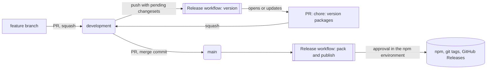

# Development workflow

How a change travels from a branch to npm in this repository: branches, pull requests, changesets and releases. [CONTRIBUTING.md](CONTRIBUTING.md) covers setup and scripts; this page covers the process.

## Branches

| Branch                          | Purpose                                     | How it changes                                               |
| ------------------------------- | ------------------------------------------- | ------------------------------------------------------------ |
| `development`                   | Default branch. All work lands here.        | Pull requests, squash merged                                 |
| `main`                          | Released code only.                         | Pull requests from `development`, merged with a merge commit |
| `<type>/<slug>`                 | Your work, for example `feat/zoom-controls` | You push to it                                               |
| `changeset-release/development` | The version PR, owned by automation         | The Release workflow rewrites it                             |
| `dependabot/*`                  | Dependency updates                          | Dependabot                                                   |

A ruleset rejects other branch names. Allowed prefixes: `feat`, `fix`, `chore`, `docs`, `refactor`, `test`, `ci`, `build`, `perf`, `style`, `revert`, `feature`, `bugfix`, `hotfix`, `bug`, `changeset-release` and `dependabot`. Branches in forks can have any name.

There is no hotfix branch: fixes follow the same path as any other change.

## From a change to `development`

1. **Branch from `development`** with a name from the list above.
2. **Commit** with [Conventional Commits](https://www.conventionalcommits.org/): `<type>(<scope>): <subject>`, scopes `core`, `vue` or `docs`. Two git hooks run on every commit:
   - `pre-commit` runs lint-staged, which fixes ESLint and Stylelint problems in the staged files.
   - `commit-msg` runs commitlint. It rejects messages that break the convention, and body lines over 100 characters.
3. **Add a changeset** if the change affects `@paperpic/core` or `@paperpic/vue`. See [Changesets](#changesets).
4. **Open a pull request against `development`.** Fill in the template. The title must follow Conventional Commits with a lowercase subject, for example `feat(vue): add zoom controls`.
5. **Get it merged.** `development` requires:
   - the `ci` check (lint, typecheck, test, build) and the `pr-title` check, on a branch that is up to date with `development`;
   - one approval from a code owner (`@Unlooper`, see [CODEOWNERS](CODEOWNERS)); a new push dismisses earlier approvals;
   - every review thread resolved.

   Pull requests are **squash merged**, so the PR title becomes the only commit on `development`. Make it describe the whole change.

## Changesets

The changelog is written by people, not generated from commits. Each pull request that changes a published package carries a short note, a **changeset**, and the notes become the changelog at release time.

### When a changeset is needed

- **Needed:** any change to what `@paperpic/core` or `@paperpic/vue` ship to users, such as their source, types or styles.
- **Not needed:** tests, docs, the docs site (`apps/docs`), CI and tooling.

### How to create one

Run this on your branch and answer the prompts:

```sh
pnpm changeset
```

It writes a file such as `.changeset/zoom-controls.md`:

```md
---
"@paperpic/vue": minor
---

Add zoom controls to `PaperPic`.
```

Commit it with the rest of your change. One changeset per pull request is usual. If you change both packages, list both in the same file.

AI tools can draft this file. The maintainer's Claude Code setup, for instance, writes one from the commit type and subject. The draft is a starting point: the author owns the wording.

### Choosing the bump

| Bump    | When                                            | Example       |
| ------- | ----------------------------------------------- | ------------- |
| `patch` | Bug fixes and internal changes users cannot see | 0.1.0 → 0.1.1 |
| `minor` | New features that do not break existing code    | 0.1.0 → 0.2.0 |
| `major` | Changes that force users to change their code   | 0.1.0 → 1.0.0 |

The two packages share one version: `.changeset/config.json` puts them in a `fixed` group, so a bump to either one bumps both. A `major` bump on a 0.x version releases 1.0.0, so use it deliberately.

### Writing a good entry

The sentence goes straight into `CHANGELOG.md`, which users read.

- Describe what changes for **users of the package**, not how the code changed.
- Name public APIs in backticks: `` `PaperPic` ``, `` `normalizeRotation` ``.
- For breaking changes, add the migration steps below the first sentence. A changeset can hold several paragraphs.

Reviewers check the changeset wording like any other line of the pull request. To fix wording after merging, open a small PR that edits the `.changeset/*.md` file while it is still pending.

Each PR from a branch of this repository gets a comment, kept up to date on every push, saying whether it has a changeset and which packages it would release. A missing changeset never blocks the merge, since tests, docs and tooling need none. PRs from forks and from Dependabot get no comment, because their token cannot write one: reviewers check those by hand.

In the changelog, `@changesets/changelog-github` adds the PR link, the commit and a thanks to the author to each entry.

## Releasing



### 1. The version PR collects pending changes

On every push to `development` that leaves changesets pending, the Release workflow (`.github/workflows/release.yml`) runs `changeset version` and opens or updates a pull request titled **`chore: version packages`** from `changeset-release/development`. That PR:

- bumps the versions in both `package.json` files;
- writes the new entries into `packages/*/CHANGELOG.md`;
- deletes the consumed `.changeset/*.md` files.

It is opened with a GitHub App token, so `ci` and `pr-title` run on it like on any other PR.

The workflow rebuilds this branch on every run, so commits pushed to it by hand are lost the next time anything merges into `development`. Fix wording in the changesets instead, or edit the PR only right before merging it.

Leaving the version PR open is fine: it keeps collecting changes until the next release.

### 2. Release

1. Review the changelog in the version PR and merge it (squash) into `development`.
2. Open a pull request from `development` into `main`. `main` requires the `ci` check and a code owner approval, and only accepts **merge commits**, which keeps the history of `development` intact.
3. Merge it. The Release workflow runs on `main`:
   - `pack` builds the packages and packs the tarballs;
   - `publish` waits in the `npm` environment until a required reviewer (`@Unlooper`) approves it in the workflow run (**Review deployments**). Then it publishes to npm with trusted publishing and provenance, pushes one git tag per package (`@paperpic/core@x.y.z`, `@paperpic/vue@x.y.z`) and creates a GitHub Release for each.

Nothing has to be merged back into `development`: the versions were bumped there in step 1.

### Safety nets

- If changesets reach `main` without passing through the version PR, the `unversioned` job fails and says what to do.
- Publishing runs only when the repository variable `NPM_PUBLISH` is `true`. It is not set yet; see [RELEASE-CHECKLIST.md](RELEASE-CHECKLIST.md).
- The **Release tags** ruleset blocks deleting, moving or force-pushing any `@paperpic/*` tag, so a tag always points at the code that was published.
- The `npm` environment can only deploy from `main`, and administrators cannot skip its approval.

## Automation reference

| What                   | When                                        | Does                                                                            |
| ---------------------- | ------------------------------------------- | ------------------------------------------------------------------------------- |
| `ci.yml`               | Pushes and PRs on `development` and `main`  | `pnpm lint`, `typecheck`, `test`, `build`                                       |
| `pr-title.yml`         | PRs into `development`                      | Checks Conventional Commits and a lowercase subject                             |
| `release.yml`          | Pushes to `development` and `main`          | Version PR on `development`; publish on `main`                                  |
| `audit.yml`            | Mondays, and PRs that change the lockfile   | `pnpm audit --audit-level high` over every dependency, transitive ones included |
| `changeset-status.yml` | PRs into `development` from this repository | Comments whether the PR has a changeset and which packages it releases          |
| CodeQL                 | PRs and pushes                              | GitHub code scanning                                                            |
| Dependabot             | Weekly (npm), monthly (actions)             | npm: security fixes only. Actions: version bumps after a 7-day cooldown         |

Every action in a workflow must be pinned to a full commit SHA, and only GitHub-owned actions plus an allowlist can run. A new third-party action needs a repository admin to add it under **Settings → Actions → General**.

When a Dependabot security fix touches a dependency that a published package ships, add a changeset to its PR (usually `patch`).

GitHub's dependency graph does not read pnpm's transitive dependencies, so Dependabot never alerts on them. `audit.yml` covers that gap: when it fails, fix the advisory with a version bump or an `overrides` entry, or accept it in `auditConfig.ignoreGhsas` with a comment saying when to drop it.

## Dependencies

`pnpm-workspace.yaml` sets supply-chain rules that apply to every install:

- Node.js 26 and pnpm 12 are required; other versions fail at install time.
- New versions must be at least 24 hours old (`minimumReleaseAge`).
- Versions are saved exact, without `^`.
- An install fails if a package's trust level drops compared to its earlier releases.
- Install scripts are blocked unless a package is allowed in `allowBuilds`.
- `overrides` forces patched versions of vulnerable transitive dependencies, and `auditConfig.ignoreGhsas` lists the advisories accepted after review.
