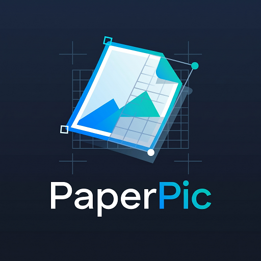

# PaperPic

[](https://github.com/paperpic/paperpic/actions/workflows/ci.yml)
[](./LICENSE)
[](https://www.gitkraken.com/)

Document image viewer & editor: zoom, rotate, perspective correction,
brightness/contrast, black & white and shadow removal.

| Package                           | Status         |
| --------------------------------- | -------------- |
| [`@paperpic/core`](packages/core) | In development |
| [`@paperpic/vue`](packages/vue)   | In development |

> Work in progress. Not ready for production.

## Development

Requires Node.js 26 and pnpm 12.

```sh
pnpm install
pnpm dev    # docs site with the playground
pnpm test
pnpm build
```

Pull requests go to `development`. `main` only receives releases.

## License

MIT
